# Practical-10

**TITLE:** Practical-10  
**AIM:** Perform implementation of any 3 modules from the modules you have designed.

---

## 1. Selected Modules & Traceability

The three modules selected for implementation are directly derived from the software engineering design artifacts (Practical-4 SRS, Practical-5 UML Diagrams, Practical-6 DFD, and Practical-7 Structure Chart):

### Module Traceability Mapping

```
DFD Process 1.0: Customer Management
        ↓
Design Phase: Customer Registration / Authentication
        ↓
Implementation: Customer Registration, Password Hashing, Session Login & Dashboard

DFD Process 2.0: Search and Filtering
        ↓
Design Phase: Product Search / Filtering
        ↓
Implementation: Product Catalog, Multi-Attribute Filtering (Category, Min/Max Price), Keyword Search

DFD Process 3.0: Shopping Cart
        ↓
Design Phase: Cart Management
        ↓
Implementation: Shopping Cart, Stock-bounded Quantity Control, Subtotal & Grand Total Calculation
```

### 1. Customer Registration / Authentication
- Implements account creation, input validation, duplicate detection, cryptographic password hashing, user session management, and protected dashboard routing.

### 2. Product Search / Filtering
- Implements the SQLite product database, catalog visualization, keyword search by product name, category filtering, minimum/maximum price constraint filtering, and dynamic multi-criteria query generation.

### 3. Cart Management
- Implements customer-isolated shopping cart persistence, stock checking, quantity increment for existing items, quantity updates, item removal, cart clearing, item subtotal calculation, and grand total calculation.

---

## 2. Technology Used

- **Programming Language:** Python 3.14
- **Web Framework:** Flask 3.1
- **Database Management System:** SQLite 3 (with Foreign Keys enabled)
- **Security:** `werkzeug.security` (PBKDF2/SHA-256 password hashing)
- **Frontend / Presentation:** HTML5, CSS3 (Vanilla Responsive Student UI)
- **Test Automation:** Python standard `unittest` framework
- **Browser Automation & Verification:** Playwright Chromium

---

## 3. Implementation

### Module 1: Customer Registration / Authentication
- **Registration (`/register`):** Collects customer name, email, password, and confirmation. Validates non-empty fields, valid email structure, minimum 6-character length, and confirmation matching. Checks for duplicate email in SQLite `customers` table. Hashes password using `generate_password_hash` before database storage.
- **Login (`/login`):** Validates submitted credentials against stored hashed passwords using `check_password_hash`. On success, establishes an authenticated HTTP session (`customer_id`, `customer_name`, `customer_email`).
- **Logout (`/logout`):** Destroys active session data (`session.clear()`) and redirects to login with flash notification.
- **Dashboard (`/dashboard`):** Protected route via `@login_required` decorator displaying personalized greeting, live store catalog count, customer's private cart item count, and quick module navigation.

### Module 2: Product Search / Filtering
- **Database Schema:** `products` table storing `id`, `name`, `category`, `price`, `stock`, and `description`.
- **Sample Dataset:** Seeded automatically on initialization with 10 sample products across 5 categories (*Electronics*, *Clothing*, *Footwear*, *Accessories*, *Bags*).
- **Filtering Engine (`/products`):** Generates parameterized SQL queries based on active user parameters:
  - Name keyword matching: `name LIKE ?`
  - Category matching: `category = ?`
  - Minimum price threshold: `price >= ?`
  - Maximum price threshold: `price <= ?`
- Displays individual product cards with category badges, formatted currency (`₹`), real-time stock levels, and inline quantity-bounded "Add to Cart" forms.

### Module 3: Cart Management
- **Database Schema:** `cart_items` table storing `id`, `customer_id`, `product_id`, and `quantity`, with foreign key constraints cascading on deletion.
- **Add to Cart (`/cart/add`):** Checks product stock. If the product already exists in the customer's cart, increments the existing row's quantity instead of creating a duplicate row. Rejects requests exceeding available inventory.
- **View Cart (`/cart`):** Strictly fetches items where `customer_id = session['customer_id']` joined with `products`. Calculates:
  - $\text{Item Subtotal} = \text{Product Price} \times \text{Quantity}$
  - $\text{Cart Grand Total} = \sum \text{Item Subtotals}$
- **Update Quantity (`/cart/update/<id>`):** Validates that requested quantity is $\le \text{Stock}$. Updates database record.
- **Remove & Clear (`/cart/remove/<id>`, `/cart/clear`):** Deletes single items or wipes the entire customer cart.

---

## 4. Important Code

### 4.1 Database Initialization & Schema (`database.py`)
```python
def init_db():
    conn = get_db_connection()
    cursor = conn.cursor()

    # Customers table with hashed password storage
    cursor.execute("""
    CREATE TABLE IF NOT EXISTS customers (
        id INTEGER PRIMARY KEY AUTOINCREMENT,
        name TEXT NOT NULL,
        email TEXT UNIQUE NOT NULL,
        password_hash TEXT NOT NULL,
        created_at TIMESTAMP DEFAULT CURRENT_TIMESTAMP
    );
    """)

    # Products table
    cursor.execute("""
    CREATE TABLE IF NOT EXISTS products (
        id INTEGER PRIMARY KEY AUTOINCREMENT,
        name TEXT NOT NULL,
        category TEXT NOT NULL,
        price REAL NOT NULL,
        stock INTEGER NOT NULL,
        description TEXT
    );
    """)

    # Cart items table with foreign keys & unique customer-product constraint
    cursor.execute("""
    CREATE TABLE IF NOT EXISTS cart_items (
        id INTEGER PRIMARY KEY AUTOINCREMENT,
        customer_id INTEGER NOT NULL,
        product_id INTEGER NOT NULL,
        quantity INTEGER NOT NULL DEFAULT 1,
        FOREIGN KEY (customer_id) REFERENCES customers (id) ON DELETE CASCADE,
        FOREIGN KEY (product_id) REFERENCES products (id) ON DELETE CASCADE,
        UNIQUE (customer_id, product_id)
    );
    """)
    conn.commit()
    conn.close()
```

### 4.2 Module 1: Registration & Password Hashing (`app.py`)
```python
@app.route("/register", methods=["GET", "POST"])
def register():
    if request.method == "POST":
        name = request.form.get("name", "").strip()
        email = request.form.get("email", "").strip().lower()
        password = request.form.get("password", "")
        confirm_password = request.form.get("confirm_password", "")

        # Validations
        if not name or not email or not password or not confirm_password:
            flash("All fields are required.", "danger")
            return render_template("register.html", name=name, email=email)

        if not re.match(r"^[\w\.-]+@[\w\.-]+\.[a-zA-Z]{2,}$", email):
            flash("Please enter a valid email address.", "danger")
            return render_template("register.html", name=name, email=email)

        if len(password) < 6:
            flash("Password must be at least 6 characters long.", "danger")
            return render_template("register.html", name=name, email=email)

        if password != confirm_password:
            flash("Passwords do not match. Please re-enter.", "danger")
            return render_template("register.html", name=name, email=email)

        conn = get_db_connection()
        if conn.execute("SELECT id FROM customers WHERE email = ?;", (email,)).fetchone():
            conn.close()
            flash("An account with this email already exists. Please login.", "danger")
            return render_template("register.html", name=name, email=email)

        password_hash = generate_password_hash(password)
        conn.execute("INSERT INTO customers (name, email, password_hash) VALUES (?, ?, ?);",
                     (name, email, password_hash))
        conn.commit()
        conn.close()
        flash("Registration successful! Please login with your credentials.", "success")
        return redirect(url_for("login"))
    return render_template("register.html")
```

### 4.3 Module 2: Parameterized Product Search & Filtering (`app.py`)
```python
@app.route("/products")
@login_required
def products():
    search_query = request.args.get("search", "").strip()
    selected_category = request.args.get("category", "").strip()
    min_price = request.args.get("min_price", "").strip()
    max_price = request.args.get("max_price", "").strip()

    conn = get_db_connection()
    categories_rows = conn.execute("SELECT DISTINCT category FROM products ORDER BY category;").fetchall()
    categories = [row["category"] for row in categories_rows]

    query = "SELECT * FROM products WHERE 1=1"
    params = []

    if search_query:
        query += " AND name LIKE ?"
        params.append(f"%{search_query}%")
    if selected_category:
        query += " AND category = ?"
        params.append(selected_category)
    if min_price:
        try:
            query += " AND price >= ?"
            params.append(float(min_price))
        except ValueError:
            pass
    if max_price:
        try:
            query += " AND price <= ?"
            params.append(float(max_price))
        except ValueError:
            pass

    query += " ORDER BY id ASC;"
    products_list = conn.execute(query, params).fetchall()
    conn.close()
    return render_template("products.html", products=products_list, categories=categories,
                           search_query=search_query, selected_category=selected_category,
                           min_price=min_price, max_price=max_price)
```

### 4.4 Module 3: Cart Management & Subtotal / Total Calculation (`app.py`)
```python
@app.route("/cart")
@login_required
def view_cart():
    customer_id = session["customer_id"]
    conn = get_db_connection()
    cart_rows = conn.execute("""
        SELECT ci.id AS cart_item_id, ci.quantity, p.id AS product_id,
               p.name, p.category, p.price, p.stock
        FROM cart_items ci
        JOIN products p ON ci.product_id = p.id
        WHERE ci.customer_id = ?
        ORDER BY ci.id DESC;
    """, (customer_id,)).fetchall()
    conn.close()

    items = []
    cart_total = 0.0
    for row in cart_rows:
        subtotal = round(row["price"] * row["quantity"], 2)
        cart_total += subtotal
        items.append({
            "cart_item_id": row["cart_item_id"],
            "name": row["name"],
            "category": row["category"],
            "price": row["price"],
            "stock": row["stock"],
            "quantity": row["quantity"],
            "subtotal": subtotal
        })

    return render_template("cart.html", items=items, cart_total=round(cart_total, 2))
```

---

## 5. Test Cases

The application was verified with automated test executions covering all 25 test cases:

| Test Case | Input/Action | Expected Result | Actual Result |
|---|---|---|---|
| **TC-01: Valid Registration** | Name: "Mayank Viradiya", Email: "mayank.viradiya@example.com", Pass: "secret123", Confirm: "secret123" | Customer record created in SQLite, redirect to `/login` with success alert | Pass |
| **TC-02: Empty Fields Registration** | Name: "", Email: "mayank.viradiya@example.com", Pass: "secret123" | Reject submission, show "All fields are required" | Pass |
| **TC-03: Invalid Email Format** | Email: "not-an-email", Pass: "secret123" | Reject submission, show "Please enter a valid email address" | Pass |
| **TC-04: Password Confirmation Mismatch** | Pass: "password123", Confirm: "different123" | Reject submission, show "Passwords do not match" | Pass |
| **TC-05: Duplicate Email Registration** | Register with already existing email | Reject submission, show "An account with this email already exists" | Pass |
| **TC-06: Correct Credentials Login** | Email: "mayank.viradiya@example.com", Password: "secret123" | Authenticate session, redirect to `/dashboard`, show greeting | Pass |
| **TC-07: Incorrect Password Login** | Email: "mayank.viradiya@example.com", Password: "wrongpassword" | Authentication denied, show "Invalid email or password" | Pass |
| **TC-08: Logout Action** | Click Logout link from dashboard | Session terminated, redirect to `/login`, dashboard restricted | Pass |
| **TC-09: Display All Products** | Navigate to `/products` as authenticated user | All 10 seed products rendered across 5 categories | Pass |
| **TC-10: Search Product by Name** | Search query: "Headphones" | Displays only "Noise-Canceling Wireless Headphones" | Pass |
| **TC-11: Category Filter** | Select category: "Footwear" | Displays only sports shoes and canvas sneakers | Pass |
| **TC-12: Minimum Price Filter** | Min Price: "2000" | Excludes items with price < ₹2000 (shows ₹2999 headphones) | Pass |
| **TC-13: Maximum Price Filter** | Max Price: "800" | Excludes items with price > ₹800 (shows ₹499 T-Shirt, ₹699 Sunglasses) | Pass |
| **TC-14: Combined Filters** | Keyword: "Watch", Category: "Accessories", Min: 1000, Max: 2000 | Displays only "Minimalist Stainless Steel Wristwatch" | Pass |
| **TC-15: No Matching Results** | Search query: "NonExistentItem999" | Displays friendly "No products found" message | Pass |
| **TC-16: Clear Filters** | Click "Clear" button on filter bar | Query parameters reset, full 10-item catalog displayed | Pass |
| **TC-17: Add Product to Cart** | Select Product ID 1 with Quantity = 2 | Item added to `cart_items`, redirect to `/cart`, shows alert | Pass |
| **TC-18: Add Same Product Again** | Add Product ID 1 again with Quantity = 3 | Existing row quantity updated from 2 to 5 without duplicate row | Pass |
| **TC-19: Update Cart Quantity** | Change cart item quantity to 4 and click Update | Quantity updated in SQLite, subtotal recalculated | Pass |
| **TC-20: Remove Item from Cart** | Click Remove button on specific item | Item deleted from `cart_items` table, cart refreshed | Pass |
| **TC-21: Clear Entire Cart** | Click Clear Cart button | All items belonging to customer deleted, empty state shown | Pass |
| **TC-22: Quantity Exceeding Stock** | Attempt to add Quantity = 999 (Stock = 15) | Action blocked, show alert: "Cannot add... Only 15 item(s) in stock" | Pass |
| **TC-23: Correct Subtotal Calculation** | Unit Price: ₹499.00, Quantity: 3 | Item Subtotal calculated correctly as ₹1497.00 | Pass |
| **TC-24: Correct Cart Total Calculation** | Subtotals: ₹998.00 + ₹1199.00 | Grand Total calculated correctly as ₹2197.00 | Pass |
| **TC-25: Cart Access Requires Login & Isolation** | Access `/cart` unauthenticated; view cart as Customer B | Unauthenticated redirected to login; Customer B sees 0 items from Customer A | Pass |

---

## 6. Output & Screenshots

All 11 actual screenshots were captured using automated browser sessions on the live Flask web application:

### Screenshot 1: Customer Registration Page
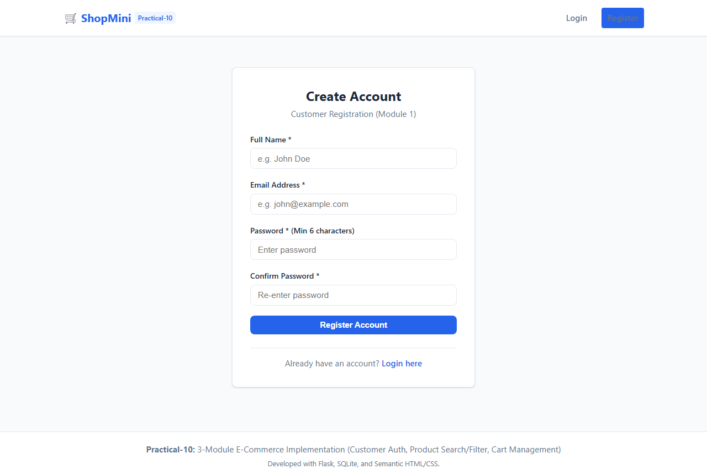

### Screenshot 2: Successful Registration Alert
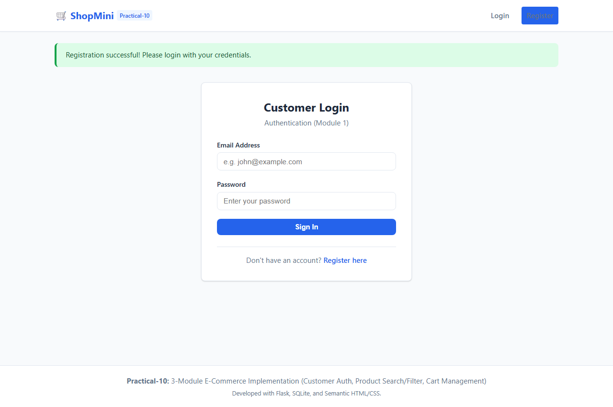

### Screenshot 3: Customer Login Page
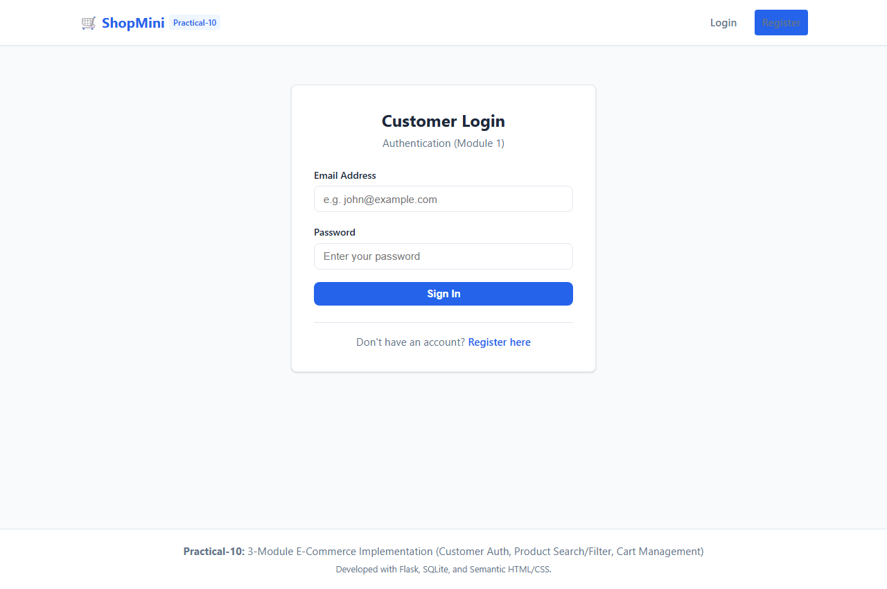

### Screenshot 4: Customer Dashboard
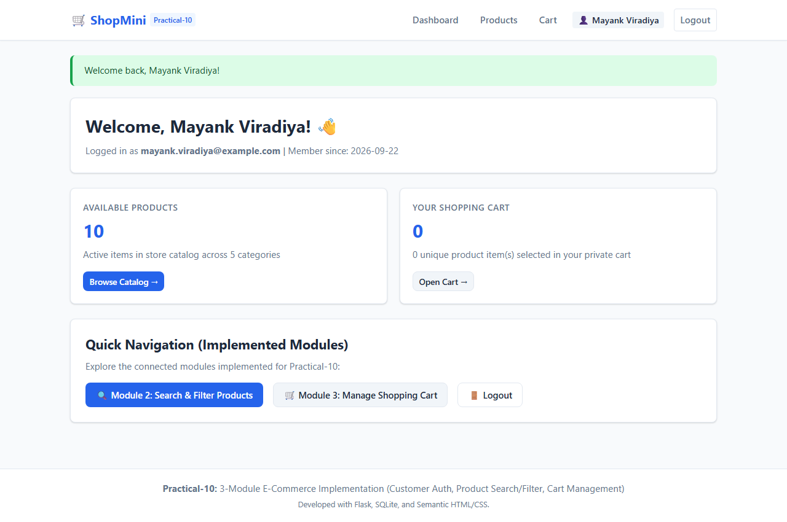

### Screenshot 5: Product Catalog (All Seed Products)
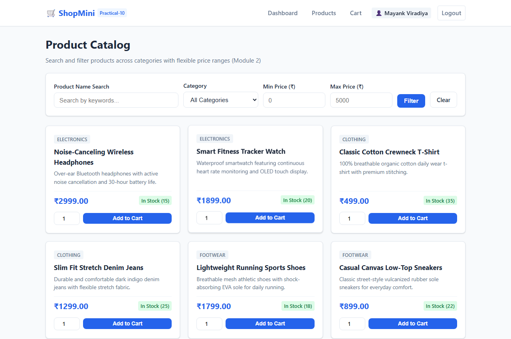

### Screenshot 6: Product Search (Keyword "Headphones")
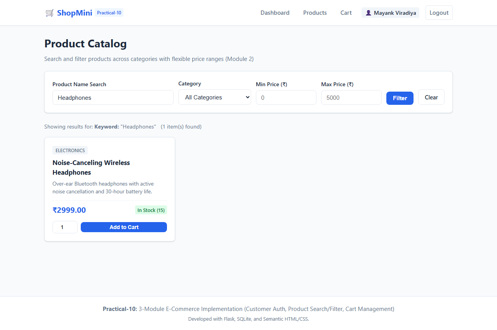

### Screenshot 7: Product Filtering (Category "Footwear" & Price Range ₹500–₹2000)
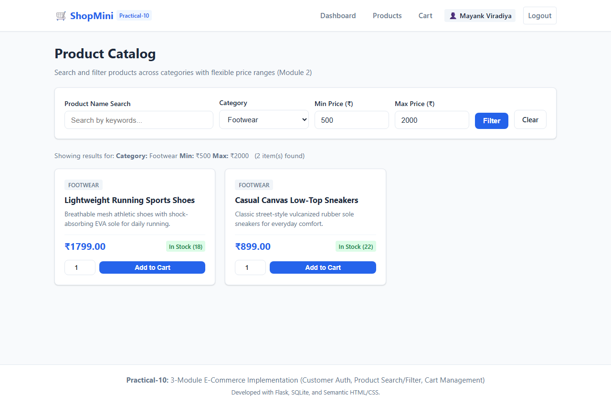

### Screenshot 8: Product Added to Cart Confirmation
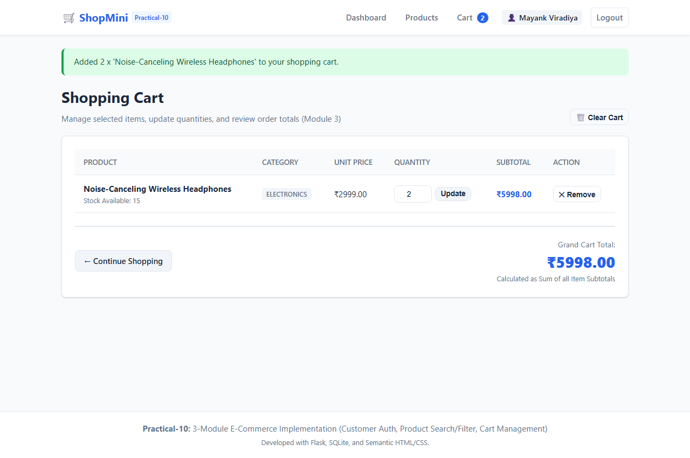

### Screenshot 9: Shopping Cart View (Subtotals & Grand Total)
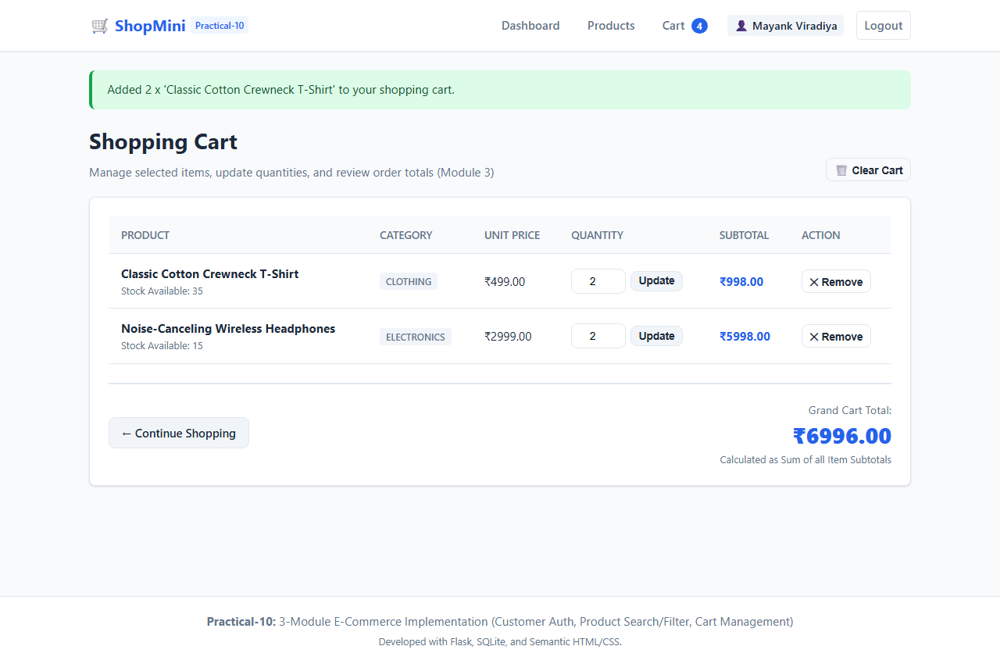

### Screenshot 10: Updated Cart Quantity
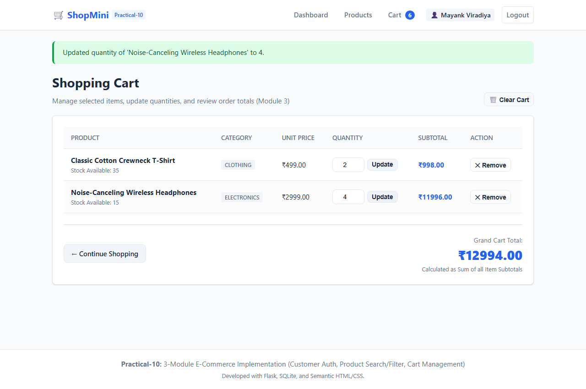

### Screenshot 11: Removed Product / Final Cart View
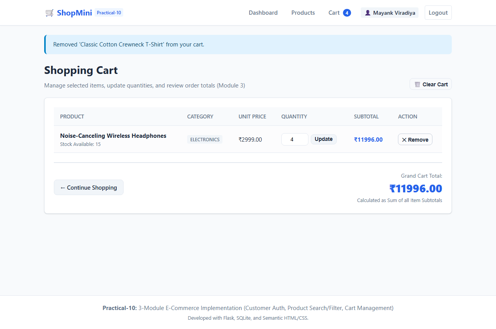

---

## 7. Result

The three selected modules—**Customer Registration / Authentication**, **Product Search / Filtering**, and **Cart Management**—were successfully implemented from scratch using Python, Flask, SQLite, and semantic HTML5/CSS3. All three modules are seamlessly integrated into a cohesive web application. The application was thoroughly validated with **25 automated test cases (all passing)** and live browser execution, verifying strict data isolation, validation rules, accurate calculations, and complete traceability to prior design specifications.
